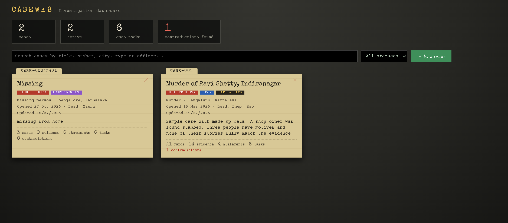
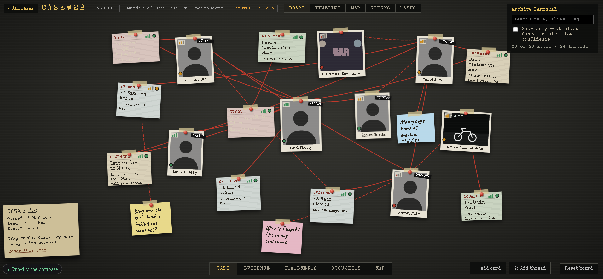
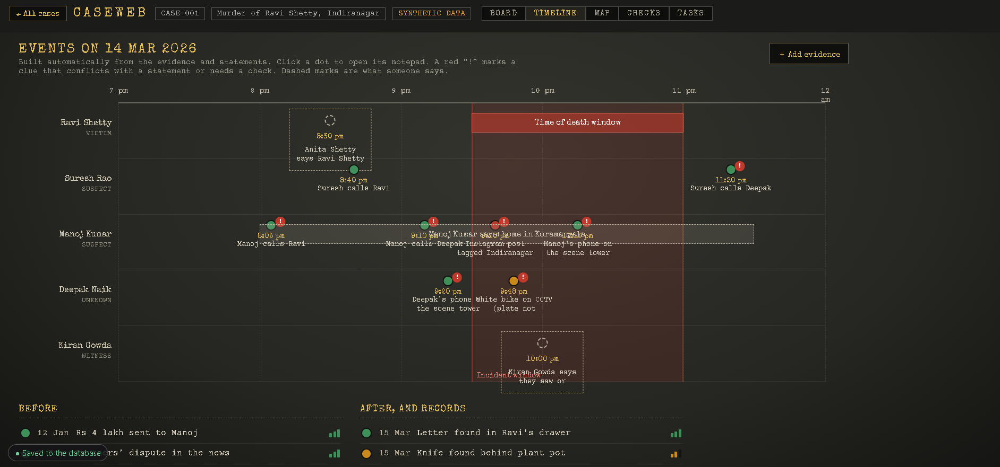
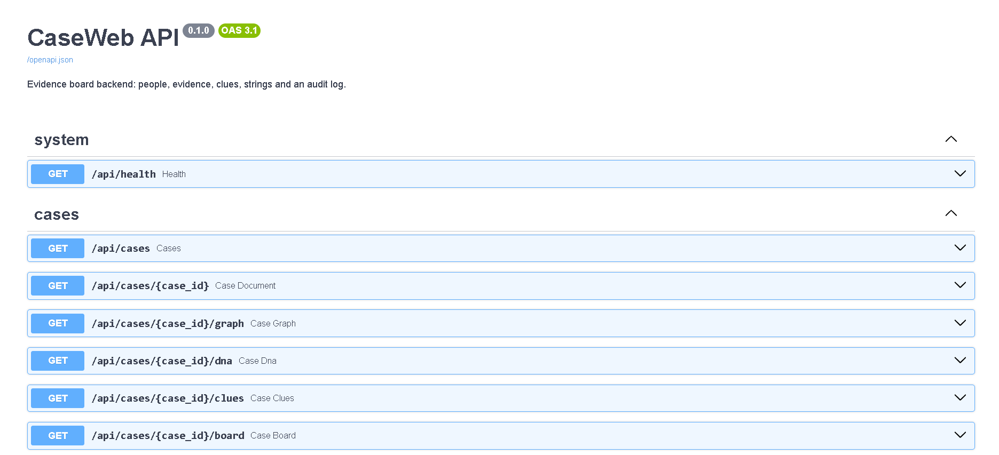

# CaseWeb

An investigation evidence board. Detectives pin people, evidence, statements and clues on a board, connect them with threads, and let the app point out where statements and evidence contradict each other. All cases are stored in a database behind a FastAPI backend.

> All data in this project is **synthetic** (made up). It is a portfolio prototype, not a tool used by real investigators.



## What it does

- **Case dashboard:** open cases, search and filter them, and see counts of cards, evidence, statements, open tasks and contradictions
- **Evidence board:** cards for people and evidence, joined by threads, to see how everything connects
- **Statements and evidence records:** keep what each person said next to what the evidence shows
- **Contradiction checks:** the app flags statements that do not match the evidence
- **Timeline, map and tasks:** put events in order, pin places on a map, and track what still needs doing
- **Saved in a database:** cases are stored by the backend, so they survive closing the browser and open on any browser
- **Works offline:** if the backend is down, the app keeps working and sends the changes when it is back




## Tech stack

| Part | Technology |
|---|---|
| Frontend | React, TypeScript, Vite |
| Backend | Python, FastAPI, Uvicorn, Pydantic |
| Database | SQLite |
| API docs | Swagger UI (generated by FastAPI at `/docs`) |

## How it fits together

```
React app (browser)  <-->  FastAPI backend  <-->  SQLite database
```

- The React app saves each case as documents. A small sync layer (`frontend/src/lib/sync.ts`) loads them from the backend when the app starts and sends every save or delete to the backend.
- If the backend cannot be reached, changes are kept in the browser and uploaded later. Unsent changes are never overwritten by older data from the database.
- The backend also has endpoints for people, evidence, statements, clues, strings between items, DNA comparison and an audit log of changes.



## Run it on your computer

You need Python 3.10+ and Node.js 18+.

**1. Backend**

```
cd backend
pip install -r requirements.txt
uvicorn main:app --reload
```

The API is at http://127.0.0.1:8000 and its documentation at http://127.0.0.1:8000/docs. The database file `caseweb.db` is created and filled with a sample case the first time.

**2. Frontend** (in a second terminal)

```
cd frontend
npm install
npm run dev
```

Open http://localhost:5173

## Project structure

```
backend/
  main.py             API endpoints (FastAPI)
  db.py               database tables, queries, DNA comparison, audit log
  kv.py               storage for the React app's saved cases
  generate_case.py    the made-up sample case
frontend/
  src/components/     board, cards, forms, dashboard, timeline, map, tasks
  src/data/           sample data and the store that holds a case in memory
  src/logic/          contradiction checks and timeline logic
  src/lib/sync.ts     keeps browser data and the database in step
```

## Limits and next steps

- DNA matching in the backend is a simplified demo, not real forensic statistics
- No login yet (it is a single-user prototype)
- SQLite is used for simplicity; moving to PostgreSQL is planned
- Planned: backend tests, Docker, deployment, and an AI feature that reads a witness statement and pins the people, places and times it mentions on the board

## Author

Vani Achar, MCA student. Built to learn full-stack development with React and FastAPI.
